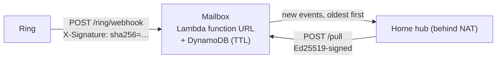

# ring-webhook-mailbox

**Receive Ring partner webhooks on a hub that lives at home, behind NAT.**

Ring delivers events (doorbell press, person detected, device offline, …) as webhooks to a public HTTPS endpoint. A home hub — a Mac mini, a Raspberry Pi, a small server in a cupboard — usually has no public address and should not get one. This project is a tiny AWS mailbox in between:



- **Ring side** follows the Ring API reference (*Notifications*): the `X-Signature` header (`sha256=` + hex HMAC-SHA256 of the **raw** body, keyed with the HMAC key issued with your partner credentials) is checked in constant time; repeats are dropped by `meta.request_id`; the answer comes well inside Ring's 5-second limit; storage trouble answers 5xx so Ring retries, bad input answers 4xx so it does not.
- **Hub side** pulls with requests signed by its own Ed25519 key. Only the hub's **public** key is configured in the cloud, so nothing stored in AWS lets anyone read the queue. Each pull is single-use (nonce) and valid for 15 seconds.
- **Data kept**: `{ type, subType, deviceId, at }` per event, for 24 hours. Thumbnails, account ids and the rest of the payload are dropped.

Built during the *Build, Ship, Shape: Amazon Developer Hackathon 2026* for [Home MCP Guardian](https://github.com/jiarong0423/ring-home-mcp-hub), where it lets a care hub at home react to a doorbell press or a camera going offline.

## Install

Version **0.1.0** ([CHANGELOG](CHANGELOG.md)). No runtime dependencies besides Node.js ≥ 20.15 (the Lambda uses the AWS SDK that ships with the Node.js runtime).

```bash
npm install github:jiarong0423/ring-webhook-mailbox#v0.1.0
```

```js
import { createMailboxClient, generateHubKey, hubPublicKeySpki } from 'ring-webhook-mailbox/client';   // on the hub
import { createMailbox, ringSignatureOk } from 'ring-webhook-mailbox';                                  // your own handler
import { createMemoryStore } from 'ring-webhook-mailbox/store';                                         // tests
```

Using it in your own project takes four steps: deploy the stack below, register its `WebhookUrl` with your Ring app, give your hub the `MailboxBaseUrl` and its private key, and handle `onEvent` (see *Use it from the hub*). Nothing in it is specific to Home MCP Guardian.

## Deploy (AWS CloudFormation)

Requirements: an AWS account, Node.js ≥ 20.15, the AWS CLI.

```bash
npm test
node scripts/build.mjs dist          # prints { sha256, bytes, key }
aws s3 cp dist/ring-webhook-mailbox.zip "s3://<your-bucket>/<key printed above>"
```

Create a stack from `template.json` with:

| Parameter | Value |
|---|---|
| `HubPublicKeySpki` | your hub's Ed25519 public key (see below) |
| `RingWebhookHmacKey` | the HMAC key from your Ring partner credentials (NoEcho; empty = webhooks answered 503) |
| `CodeBucket`, `CodeKey` | where you uploaded the zip |

The HMAC key must be at least 16 characters: the template accepts 16–256 printable ASCII characters without spaces, and the mailbox refuses every signature made with a shorter key.

Outputs: `WebhookUrl` (register it as your Ring app's webhook URL) and `MailboxBaseUrl` (for the hub).

Resources: one DynamoDB table (on-demand, TTL, encrypted), one Lambda function (arm64, 5 s timeout) with a role that can only `GetItem` / `PutItem` on that table and write its own logs, and a function URL.

## Use it from the hub

```js
import { createMailboxClient, generateHubKey, hubPublicKeySpki } from './client/mailbox-client.mjs';

const key = generateHubKey();                 // keep it: export it to a 0600 file and load it next time
console.log(hubPublicKeySpki(key));           // -> HubPublicKeySpki parameter

const mailbox = createMailboxClient({
  base: process.env.MAILBOX_BASE_URL,
  privateKey: key,
  onEvent: (e) => {                            // { seq, type, subType, deviceId, at }
    if (e.type === 'button_press') console.log('doorbell', e.deviceId);
    if (e.type === 'device_offline') console.log('camera offline', e.deviceId);
  }
});
const stop = mailbox.start({ intervalMs: 10_000, onError: (err) => console.error('ERROR mailbox pull', err.code ?? err.message) });
```

The first pull only records the queue position, so events that arrived before the hub started are never acted on.

## Event types kept

`button_press`, `motion_detected` (with `sub_type`, e.g. `human`), `person_detected`, `device_online`, `device_offline`. Other types are acknowledged (2xx) and not stored. To change the list, pass `eventTypes` to `createMailbox` in your own handler; the deployed `src/handler.mjs` does not pass it, so it keeps these five.

## Tests

`npm test` runs everything in memory: signature checks (exact bytes, wrong key, missing prefix, re-serialized JSON), handler status codes (503 / 401 / 400 / 413 / 404, base64 bodies), the documented-shape example payloads in `examples/`, repeats, the client's first-pull baseline and ordering (20 per pull), pulls signed by a different key, replayed and stale pulls, the deterministic bundle and the template's least-privilege policy.

## Limits

- Receiving real Ring webhooks needs Ring partner credentials with a webhook URL configured; the Ring Developer Playground's short-lived access tokens do not deliver webhooks. This project was built and tested with payloads shaped like the examples in the Ring API reference, not with live deliveries.
- Events are polled, not pushed: with a 10-second interval a doorbell press reaches the hub within about 10 seconds.
- One hub per mailbox (one public key).

## License

MIT — see [LICENSE](LICENSE).
